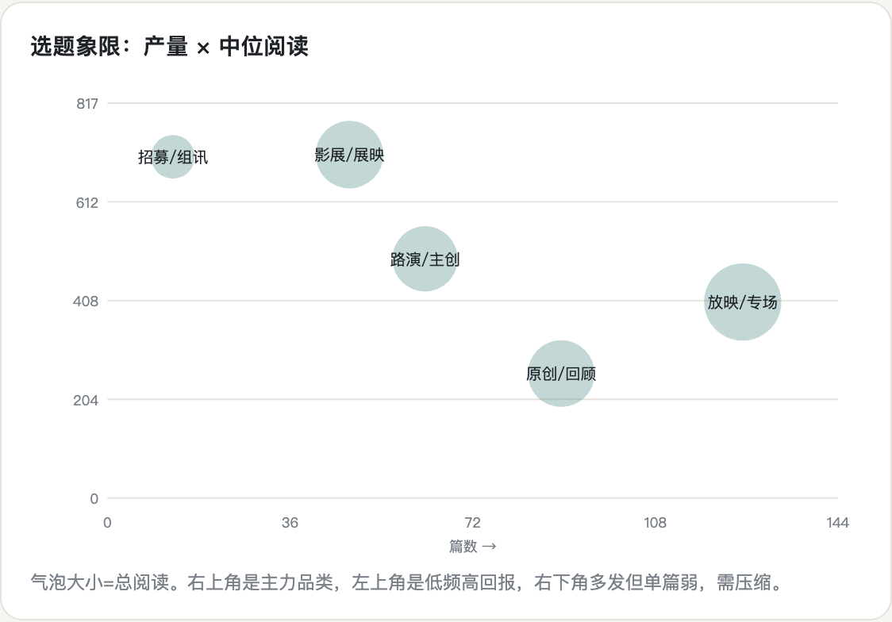
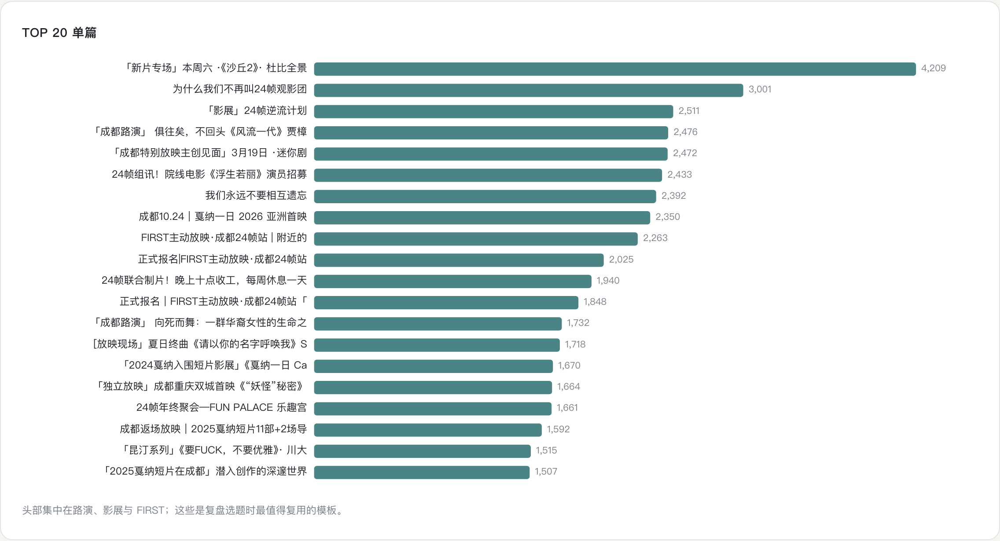
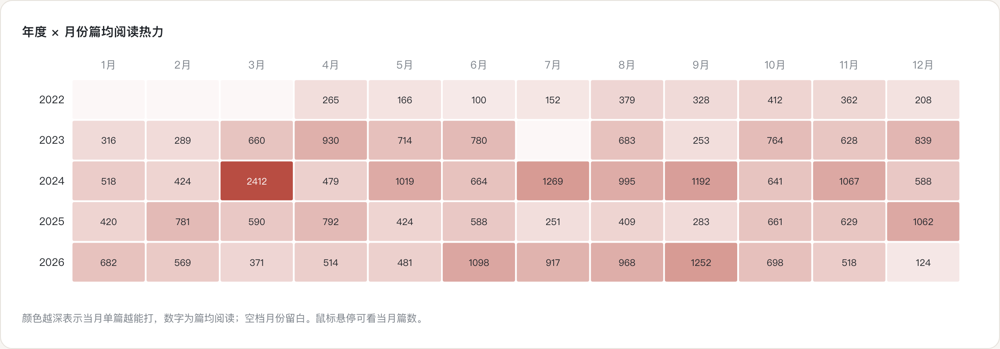
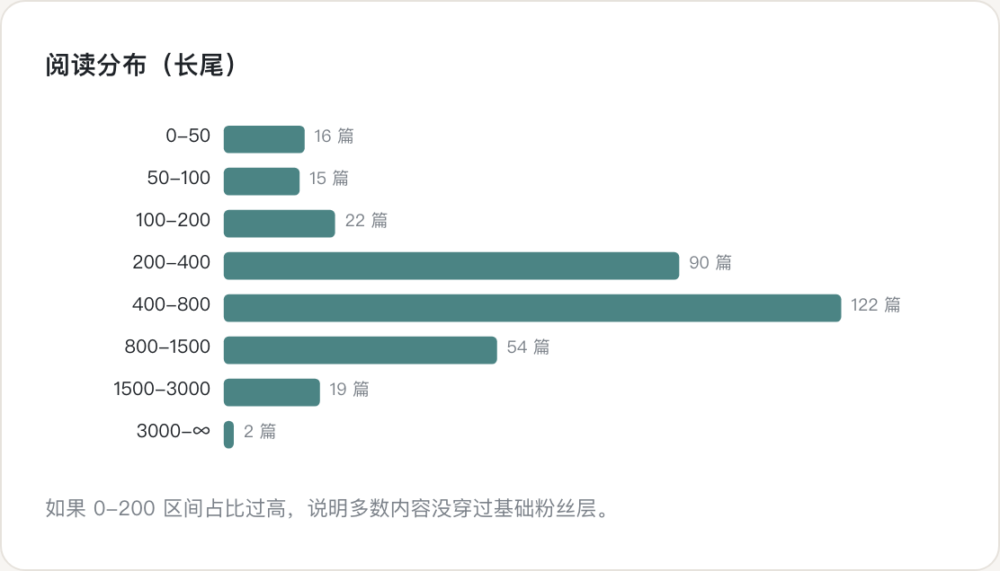
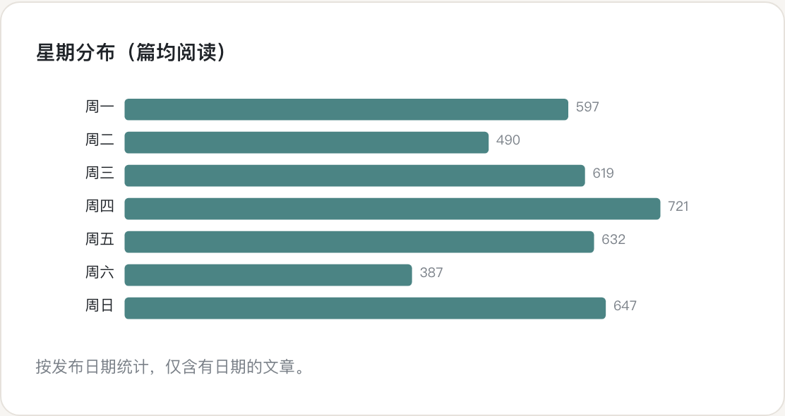
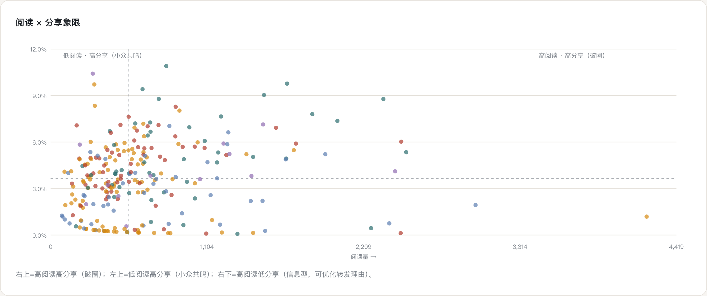

# 公众号数据看板

> 数据抓取：2026-11-18 01:03 ｜ 后台 350 条去重后 340 篇 ｜ 累计阅读 200,895

## 核心指标

| 指标 | 数值 | 说明 |
|---|---|---|
| 存档篇数 | 331 | 年份目录实际文件 |
| 后台篇数 | 340 | 短链/tempkey 去重后 |
| 累计阅读 | 200,895 | 340 篇有数据 |
| 篇均阅读 | 591 | 中位 456 |
| P90 阅读 | 1,209 | 头部线 |
| 分享率 | 3.6% | 分享 7,298 |

## 发现与建议

- 路演/主创类中位阅读 495，是日常放映类的 **1.2 倍**，仍是流量杠杆。
- 前 10% 的文章贡献了 **31%** 的阅读，长尾极长，选题要围绕头部事件。
- 近 12 个月篇均阅读 692，较此前 12 个月 **+18%**。
- 发布效果最好的星期是 **周四**（篇均 718），可把重点推文排到这一天。
- 系列里篇均最高的是 **组讯/招募**（1056），可评估是否加大该系列排期。
- 招募/组讯类共 13 篇，篇均 905，业务信息同样能带来稳定阅读。

## 月度节奏

## 分类表现

| 类别 | 篇数 | 中位阅读 | 篇均阅读 | 分享率 |
|---|---|---|---|---|
| 影展/展映 | 48 | 710 | 917 | 5.3% |
| 招募/组讯 | 13 | 706 | 905 | 4.6% |
| 路演/主创 | 63 | 495 | 636 | 4.4% |
| 放映/专场 | 126 | 406 | 497 | 2.6% |
| 原创/回顾 | 90 | 258 | 472 | 2.4% |

## 选题象限

## 年度汇总

| 年份 | 篇数 | 总阅读 | 篇均 | 中位 | 分享率 | 篇均间隔(天) |
|---|---|---|---|---|---|---|
| 2022 | 57 | 14,125 | 248 | 204 | 0.3% | 3 |
| 2023 | 72 | 41,742 | 580 | 490 | 0.7% | 3 |
| 2024 | 72 | 59,212 | 822 | 648 | 4.6% | 4 |
| 2025 | 66 | 42,752 | 648 | 468 | 5.3% | 3 |
| 2026 | 64 | 41,582 | 650 | 498 | 4.6% | 4 |

> 2024 年前分享率异常偏低，可能是后台统计口径变化，不宜跨年直接对比。

## TOP 20

## 年度 × 月份篇均阅读

## 长尾与头部集中度

## 标题特征与发布星期

## 片名复现

## 系列逐年表现

| 系列 | 年份 | 篇数 | 篇均 | 最高 |
|---|---|---|---|---|
| FIRST 主动放映 | 2023 | 2 | 1486 | 2,263 |
| FIRST 主动放映 | 2024 | 9 | 1102 | 1,848 |
| FIRST 主动放映 | 2025 | 8 | 999 | 2,025 |
| FIRST 主动放映 | 2026 | 6 | 706 | 1,089 |
| 戛纳短片/一日 | 2022 | 1 | 179 | 179 |
| 戛纳短片/一日 | 2024 | 4 | 1039 | 1,670 |
| 戛纳短片/一日 | 2025 | 4 | 1072 | 1,592 |
| 戛纳短片/一日 | 2026 | 2 | 1318 | 2,350 |

## 阅读 × 分享象限

## 正文长度 vs 阅读量

## 数据去重明细

| 文章 | 后台条数 | 取最大阅读 |
|---|---|---|
| 「独立放映」《锔瓷》 成都首映 ｜ 第18届FIRST青年电影展最佳剧情长片 | 2 | 726 |
| 东 京 教 父 | 2 | 28 |
| 回顾｜2026戛纳一日Cannes Framewaves | 7 | 285 |
| 成都（8.16）｜戛纳·威尼斯·柏林短片精选集 | 2 | 817 |
| 「新片专场」《金的音像店》致敬电影精神 | 2 | 287 |

> 后台 350 条图文，按标题归一化去重后 340 篇；同一篇的短链/tempkey 多份只计一次。存档正文零重复。

## 近 90 天文章（最近 12 条）

| 日期 | 文章 | 阅读量 | 类别 |
|---|---|---|---|
| 2026-10-26 | 「专场」10.30《笑傲江湖2：东方不败》 | 104 | 放映/专场 |
| 2026-11-02 | 让影像长河多一种奔涌的方向，让一朵花同时落入千百片湖 | 411 | 原创/回顾 |
| 2026-11-03 | 在一座失败的城市里，重新认识自己 | 510 | 原创/回顾 |
| 2026-11-05 | 「专场」11.11《海上钢琴师》超前点映 | 146 | 放映/专场 |
| 2026-11-05 | 回顾｜2026戛纳一日Cannes Framewaves | 285 | 影展/展映 |
| 2026-11-05 | 成都组讯！剧情短片《普通朋友》 | 1,418 | 招募/组讯 |
| 2026-11-08 | 宇航员、小乔：聊聊24帧的来时路 | 387 | 原创/回顾 |
| 2026-11-09 | 「她看见专场」1114《我们仅有一次的人生》 | 431 | 放映/专场 |
| 2026-11-14 | 爱，究竟还有没有可能？从《可能的爱》重新走进李沧东的电影世界 | 332 | 原创/回顾 |
| 2026-11-15 | 在旷野相握·年终聚会｜机构招募&志愿者招募 | 1,263 | 招募/组讯 |
| 2026-11-16 | 再往山那边飞，我们就听不到彼此了 | 233 | 原创/回顾 |
| 2026-11-17 | 「成都路演」让记忆重新漫游《上海女儿》导演沈仲旻现场交流 | 184 | 路演/主创 |

> 口径：阅读/分享为后台累计值；9 条未入档（6 条 tempkey 失效 + 3 条按规则移除）不计入图表。
