# 公众号数据看板

> 数据抓取：2026-11-07 01:46 ｜ 文章 334 篇（后台 344 条去重）｜ 累计阅读 197,464
> 交互版：[数据看板.html](数据看板.html)（浏览器打开，可悬停看数值）

## 核心指标

| 指标 | 数值 | 说明 |
|---|---|---|
| 文章总数 | 334 | 去重后 |
| 累计阅读 | 197,464 | 334 篇有数据 |
| 篇均阅读 | 591 | 中位 457 |
| P90 阅读 | 1,204 | 头部线 |
| 分享率 | 3.6% | 分享 7,144 |
| 时间跨度 | 2022-04 → 2026-11 | 325 篇有日期 |

## 自动洞察

- 路演/主创类中位阅读 490，是日常放映类的 **1.2 倍**，仍是流量杠杆。
- 前 10% 的文章贡献了 **31%** 的阅读，长尾极长，选题要围绕头部事件。
- 近 12 个月篇均阅读 703，较此前 12 个月 **+12%**。
- 发布效果最好的星期是 **周四**（篇均 714），可把重点推文排到这一天。
- 系列里篇均最高的是 **戛纳短片/一日**（1018），可评估是否加大该系列排期。
- 招募/组讯类共 12 篇，篇均 861，业务信息同样能带来稳定阅读。

## 决策清单

- 排期：把路演/主创作为月度主推（中位 490，是日常放映 405 的 1.2 倍）。
- 业务信息：招募/组讯篇均 861，建议固定每月 1 篇，兼顾招募与阅读。
- 选题结构：前 10% 文章占 31% 阅读，每月至少安排 1 个头部事件（路演/影展/FIRST），其余内容围绕它做预热与回顾。
- 发布节奏：周四篇均最高（714），重点推文优先排周四；篇均间隔中位约 4 天，保持稳定节奏。

## 月度节奏

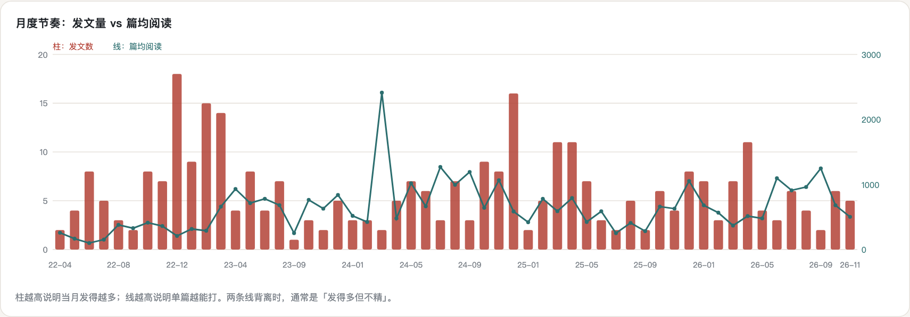

## 分类表现

| 类别 | 篇数 | 中位阅读 | 篇均阅读 | 分享率 |
|---|---|---|---|---|
| 影展/展映 | 48 | 710 | 916 | 5.3% |
| 招募/组讯 | 12 | 620 | 861 | 4.5% |
| 路演/主创 | 62 | 490 | 641 | 4.3% |
| 放映/专场 | 125 | 405 | 497 | 2.6% |
| 原创/回顾 | 87 | 240 | 475 | 2.4% |

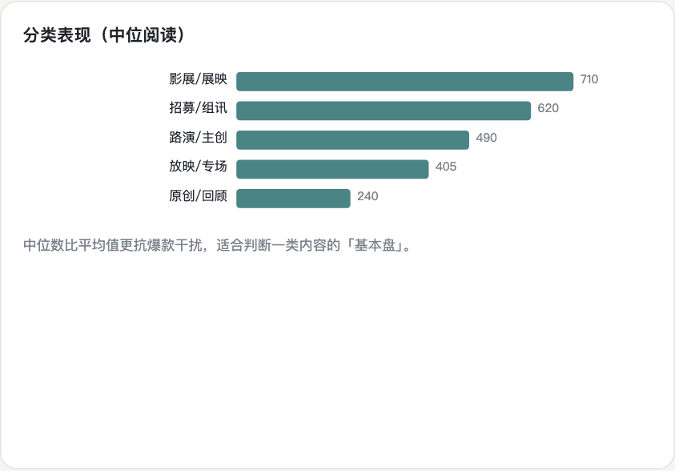

## 选题象限

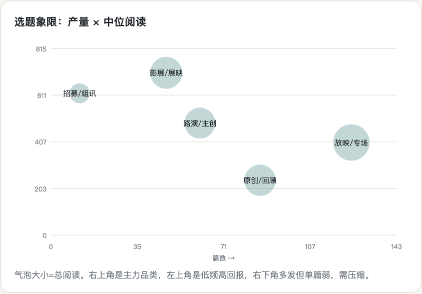

## 年度汇总

| 年份 | 篇数 | 总阅读 | 篇均 | 中位 | 分享率 | 篇均间隔(天) |
|---|---|---|---|---|---|---|
| 2022 | 57 | 14,113 | 248 | 204 | 0.3% | 3 |
| 2023 | 72 | 41,739 | 580 | 490 | 0.7% | 3 |
| 2024 | 72 | 59,173 | 822 | 648 | 4.6% | 4 |
| 2025 | 66 | 42,678 | 647 | 467 | 5.3% | 3 |
| 2026 | 58 | 38,281 | 660 | 492 | 4.6% | 4 |

> 2024 年前分享率异常偏低，可能是后台统计口径变化，不宜跨年直接对比。

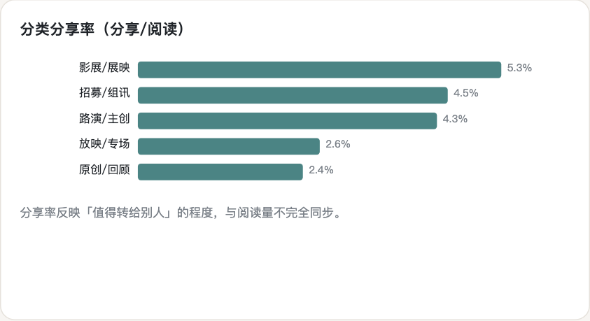

## TOP 20

| 排名 | 文章 | 阅读量 | 日期 | 类别 |
|---|---|---|---|---|
| 1 | 「新片专场」本周六 ·《沙丘2》· 杜比全景声 | 4,209 | 2024-03-07 | 放映/专场 |
| 2 | 为什么我们不再叫24帧观影团 | 2,954 | 2025-12-31 | 原创/回顾 |
| 3 | 「影展」24帧逆流计划 | 2,510 | 2024-07-10 | 影展/展映 |
| 4 | 「成都路演」 俱往矣，不回头《风流一代》贾樟柯到场交流 | 2,476 | 2024-11-15 | 路演/主创 |
| 5 | 「成都特别放映主创见面」3月19日 ·迷你剧《平原上的摩西》 | 2,472 | 2023-03-15 | 路演/主创 |
| 6 | 24帧组讯！院线电影《浮生若丽》演员招募 | 2,431 | 2026-06-19 | 招募/组讯 |
| 7 | 我们永远不要相互遗忘 | 2,392 | 2023-03-23 | 原创/回顾 |
| 8 | 成都10.24｜戛纳一日 2026 亚洲首映 | 2,334 | 2026-10-16 | 影展/展映 |
| 9 | FIRST主动放映·成都24帧站 ｜ 附近的消逝 | 2,263 | 2023-04-25 | 影展/展映 |
| 10 | 正式报名｜FIRST主动放映·成都24帧站 衔尾蛇 | 2,025 | 2025-04-24 | 影展/展映 |
| 11 | 24帧联合制片！晚上十点收工，每周休息一天 | 1,935 | 2026-07-24 | 原创/回顾 |
| 12 | 正式报名｜FIRST主动放映·成都24帧站「真实之镜：非虚构与想象力折叠」 | 1,848 | 2024-05-13 | 影展/展映 |
| 13 | 「成都路演」 向死而舞：一群华裔女性的生命之书《女人世界》制片人：徐筱到场交流+ | 1,732 | 2024-11-14 | 路演/主创 |
| 14 | [放映现场」夏日终曲《请以你的名字呼唤我》Sound with Dj:Nick | 1,718 | 2024-08-11 | 放映/专场 |
| 15 | 「2024戛纳入围短片影展」《戛纳一日 Cannes Framewaves》感受 | 1,670 | 2024-08-05 | 影展/展映 |
| 16 | 「独立放映」成都重庆双城首映《“妖怪”秘密》第18届FIRST青年电影展·主竞赛 | 1,664 | 2024-09-20 | 影展/展映 |
| 17 | 24帧年终聚会—FUN PALACE 乐趣宫殿 | 1,654 | 2025-12-29 | 原创/回顾 |
| 18 | 成都返场放映｜2025戛纳短片11部+2场导演映后连线 | 1,592 | 2025-11-24 | 路演/主创 |
| 19 | 「昆汀系列」《要FUCK，不要优雅》· 川大望江 | 1,515 | 2023-05-04 | 原创/回顾 |
| 20 | 「2025戛纳短片在成都」潜入创作的深邃世界：11 部入围短片亚洲/中国首映 | 1,507 | 2025-10-16 | 影展/展映 |

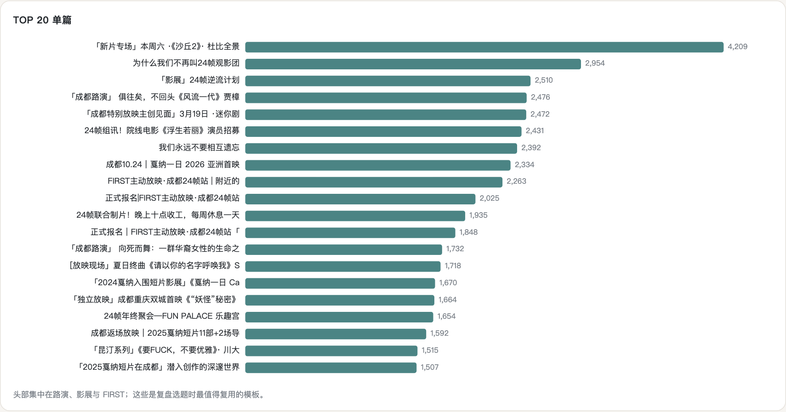

## 年度 × 月份篇均阅读

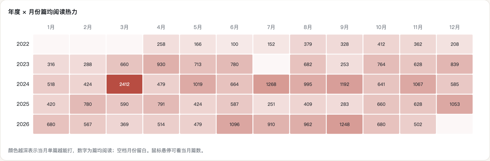

## 长尾与头部集中度

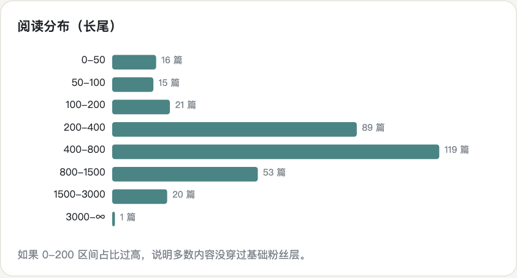

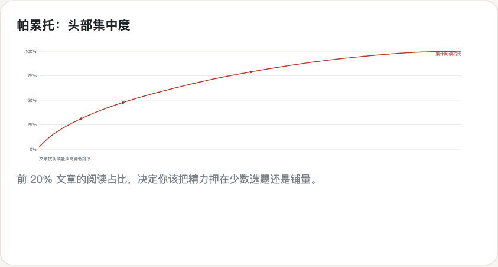

## 标题特征与发布星期

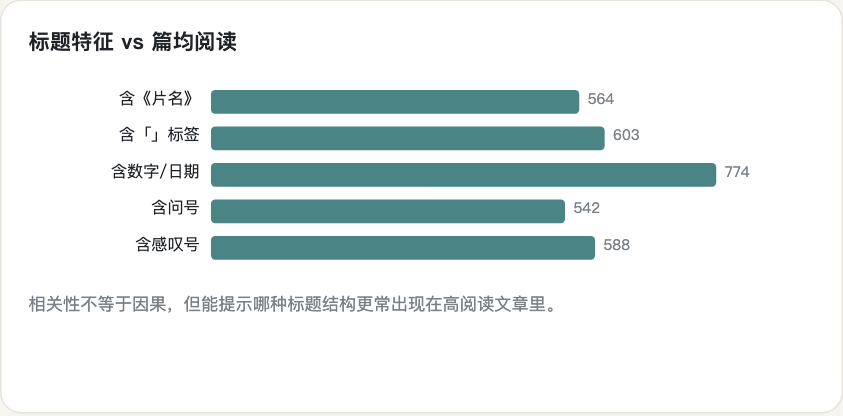

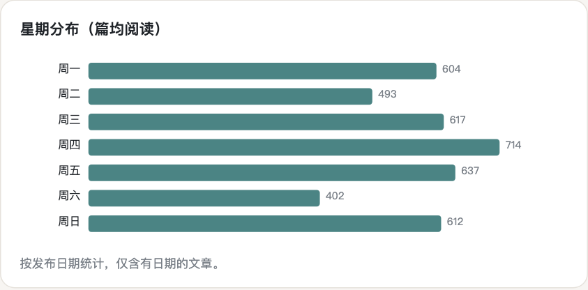

## 系列 / IP 与片名

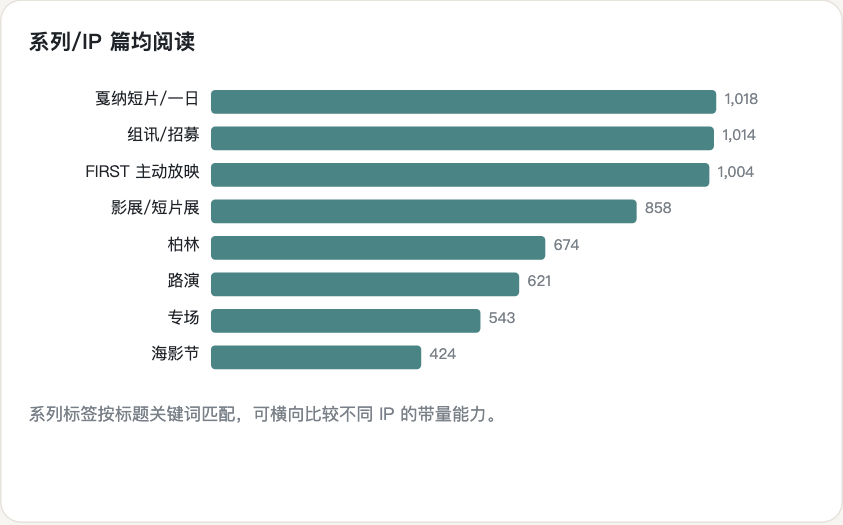

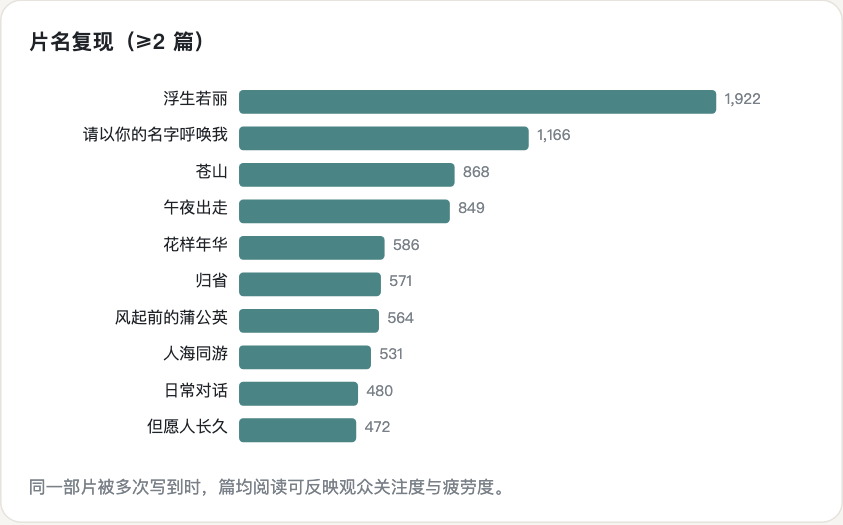

## 系列逐年表现

| 系列 | 年份 | 篇数 | 篇均 | 最高 |
|---|---|---|---|---|
| FIRST 主动放映 | 2023 | 2 | 1486 | 2,263 |
| FIRST 主动放映 | 2024 | 9 | 1102 | 1,848 |
| FIRST 主动放映 | 2025 | 8 | 998 | 2,025 |
| FIRST 主动放映 | 2026 | 6 | 705 | 1,088 |
| 戛纳短片/一日 | 2022 | 1 | 179 | 179 |
| 戛纳短片/一日 | 2024 | 4 | 1039 | 1,670 |
| 戛纳短片/一日 | 2025 | 4 | 1072 | 1,592 |
| 戛纳短片/一日 | 2026 | 2 | 1290 | 2,334 |

## 阅读 × 分享象限

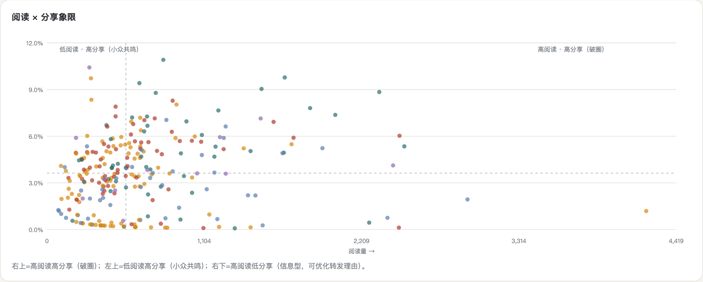

## 正文长度 vs 阅读量

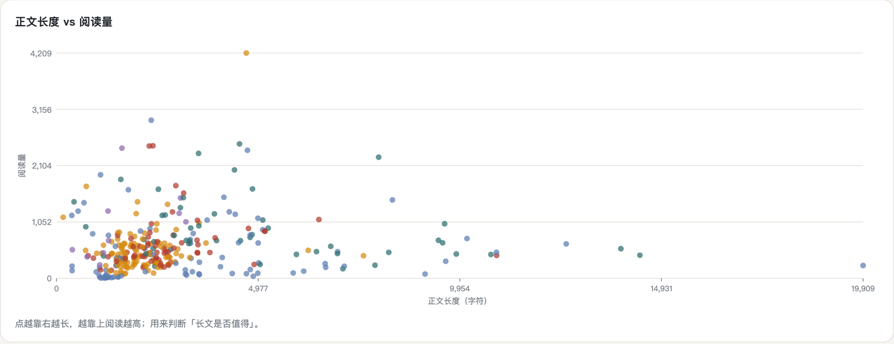

## 近 90 天文章（最近 20 条）

| 日期 | 文章 | 阅读量 | 类别 |
|---|---|---|---|
| 2026-08-10 | 「成都路演」流河无边，远人有岸《冬旅人》导演鲁丹现场交流 | 606 | 路演/主创 |
| 2026-08-12 | 「24帧 × 方所特别放映」迟来的人 · 杨一欣短片《智齿》《飞天大王》 | 877 | 路演/主创 |
| 2026-08-19 | 当我们谈论《牛来》时，我们究竟在谈论什么？ | 1,242 | 原创/回顾 |
| 2026-09-07 | 川渝院线电影《浮生若丽》计划9月16日开机 | 1,412 | 原创/回顾 |
| 2026-09-28 | 「成都路演」离开旋涡的中心，需要很大的勇气和毅力《我是001号》导演许世 | 1,083 | 路演/主创 |
| 2026-10-04 | 「成都路演」河水东流，岁月回响《水东游》导演胡兆祥现场交流 | 210 | 路演/主创 |
| 2026-10-14 | 「成都路演」在爱与生活之间《夫妻一场》导演秦潇越现场交流 | 482 | 路演/主创 |
| 2026-10-16 | 成都10.24｜戛纳一日 2026 亚洲首映 | 2,334 | 影展/展映 |
| 2026-10-17 | 「成都路演」藏地不是远方《一个夜晚与三个夏天》导演岗珍现场交流 | 482 | 路演/主创 |
| 2026-10-23 | 「专场」11.01《生日快乐》站在幸福之外 | 467 | 放映/专场 |
| 2026-10-26 | 「专场」10.30《笑傲江湖2：东方不败》 | 102 | 放映/专场 |
| 2026-11-02 | 让影像长河多一种奔涌的方向，让一朵花同时落入千百片湖 | 389 | 原创/回顾 |
| 2026-11-03 | 在一座失败的城市里，重新认识自己 | 487 | 原创/回顾 |
| 2026-11-05 | 「专场」11.11《海上钢琴师》超前点映 | 133 | 放映/专场 |
| 2026-11-05 | 回顾｜2026戛纳一日Cannes Framewaves | 245 | 影展/展映 |
| 2026-11-05 | 成都组讯！剧情短片《普通朋友》 | 1,256 | 招募/组讯 |

> 口径：阅读/分享为后台累计值；9 条未入档（6 条 tempkey 失效 + 3 条按规则移除）不计入图表。
